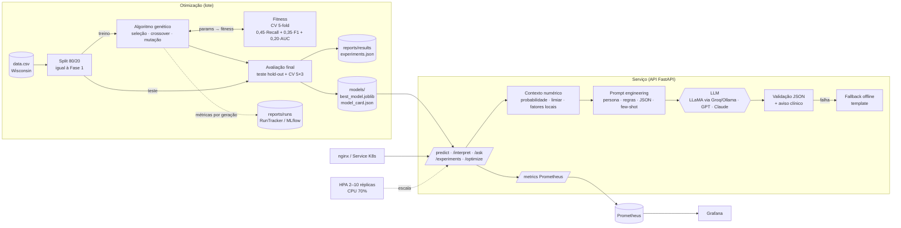

# Arquitetura e decisões de implementação — Fase 2

## Visão geral

## Componentes

| Componente | Arquivo | Responsabilidade |
|---|---|---|
| Dados | `src/data.py` | Mesmas regras de limpeza e o mesmo split (80/20, `random_state=42`) da Fase 1 |
| Modelos | `src/models.py` | Modelos originais da Fase 1 e construção do pipeline a partir de um cromossomo; `ThresholdClassifier` adiciona o limiar como hiperparâmetro |
| Codificação | `src/ga/search_space.py` | Genes `FloatGene` (linear/log), `IntGene`, `CategoricalGene` sobre um vetor real em [0,1]^d |
| Operadores | `src/ga/operators.py` | Seleção (torneio, roleta, ranking), crossover (uniforme, um ponto, BLX-α), mutação (gaussiana, uniforme) |
| Motor do AG | `src/ga/engine.py` | Laço geracional com elitismo, cache de fitness, parada antecipada, histórico e busca aleatória de referência |
| Espaços de busca | `src/spaces.py` | Genes da Regressão Logística (4) e do Random Forest (9) |
| Fitness | `src/fitness.py` | CV estratificada 5-fold só no treino, com cache de probabilidades out-of-fold |
| Experimentos | `src/experiments.py`, `configs/experiments.yaml` | 5 configurações do AG + busca aleatória por modelo, avaliação final e seleção do modelo |
| Explicação | `src/explain.py` | Contribuição local por oclusão e contexto estruturado para a LLM |
| LLM | `src/llm/` | Provedores, prompts, interpretação com fallback e avaliação de qualidade |
| Observabilidade | `src/monitoring.py`, `src/api/metrics.py` | Logs JSON com `request_id`, rastreamento de execuções, métricas Prometheus |
| API | `src/api/main.py` | Endpoints de previsão, interpretação, perguntas, resultados e jobs do AG |
| Implantação | `Dockerfile`, `docker-compose.yml`, `deploy/` | Contêiner, balanceador, Prometheus/Grafana, Kubernetes com HPA e Job de lote |

## Decisões de implementação

**1. Cromossomo real normalizado em vez de binário.** Os hiperparâmetros são mistos (contínuos, inteiros e categóricos). Representar todos como números em [0,1] e decodificar por tipo de gene permite usar os mesmos operadores para qualquer modelo e aplicar operadores próprios de codificação real (BLX-α, mutação gaussiana). Parâmetros de escala multiplicativa (`C`) usam escala logarítmica.

**2. O limiar de decisão é um gene.** Na triagem de câncer o custo de um falso negativo é muito maior que o de um falso positivo. O limiar é o controle mais direto desse equilíbrio e, no modelo da Fase 1, estava fixo em 0,5.

**3. Fitness composta e calculada só no treino.** `0,45·Recall + 0,35·F1 + 0,20·ROC-AUC` em CV estratificada 5-fold. O recall prioriza não perder casos malignos; o F1 impede a solução degenerada "tudo maligno"; o AUC mede a ordenação independentemente do limiar. O teste da Fase 1 (114 amostras) não participa da busca — é usado apenas na comparação final.

**4. Validação robusta e seleção sem olhar o teste.** O teste tem só 42 casos malignos: um caso a mais ou a menos muda o recall em 2,4 pontos. Por isso cada solução também é avaliada numa CV repetida 5×3 com outra semente, e o modelo publicado é escolhido por essa métrica, não pelo teste.

**5. Economia de computação.** Indivíduos repetidos são servidos por cache e indivíduos que diferem só no limiar reaproveitam as probabilidades out-of-fold já calculadas (sem re-treinar). Isso reduz bastante o número de treinos, principalmente no Random Forest.

**6. Busca aleatória como referência.** Para saber se o AG agrega valor além de "tentar muitas combinações", ele é comparado a uma busca aleatória com o mesmo número de avaliações.

**7. LLM ancorada em números (grounding).** A LLM não acessa o modelo: recebe um JSON com probabilidade, limiar, fatores locais (com médias de benignos e malignos) e o desempenho do modelo no teste. As regras do prompt proíbem inventar números e usar linguagem de diagnóstico definitivo, e a avaliação automática verifica as duas coisas.

**8. Provedor de LLM plugável e com fallback.** Uma interface única atende APIs compatíveis com OpenAI (GPT, LLaMA via Groq ou Ollama local, LM Studio) e a API da Anthropic. Se a LLM falhar ou responder fora do formato, a API devolve uma explicação por template (offline) e registra o evento na métrica `llm_requests_total{status="fallback"}` — o médico nunca fica sem resposta.

**9. Escalabilidade.** A API é sem estado (o modelo é carregado de arquivo na inicialização), então escala horizontalmente: no Docker Compose com `--scale api=N` atrás do nginx; no Kubernetes com HPA de 2 a 10 réplicas por CPU/memória, sondas de prontidão e `PodDisruptionBudget`. A otimização pesada não roda dentro da API em produção: vai para um `Job` indexado (um pod por modelo). A rota `/optimize` existe para demonstração e roda no máximo um job por réplica.

**10. Observabilidade.** Logs estruturados em JSON (com `request_id` propagado) e métricas Prometheus: volume e latência por rota, requisições em andamento, distribuição das probabilidades previstas (detecta *drift* de entrada), chamadas/latência/fallback da LLM, jobs do AG em execução e o melhor fitness. Execuções do AG são gravadas por geração em `reports/runs/` (e no MLflow, se configurado).

## Alertas sugeridos

| Alerta | Expressão PromQL | Motivo |
|---|---|---|
| Erros 5xx | `sum(rate(http_requests_total{status=~"5.."}[5m])) / sum(rate(http_requests_total[5m])) > 0.05` | Falha da API |
| Latência | `histogram_quantile(0.95, rate(http_request_duration_seconds_bucket{path="/predict"}[5m])) > 0.5` | Saturação — sinal para escalar |
| LLM indisponível | `rate(llm_requests_total{status="fallback"}[10m]) > 0` | Provedor fora ou chave inválida |
| Drift | mudança na média de `prediction_malignancy_probability` | População atendida mudou; revalidar o modelo |
