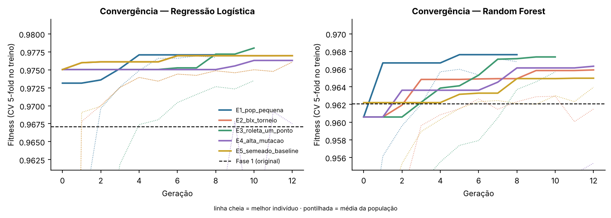
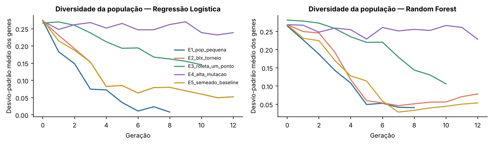
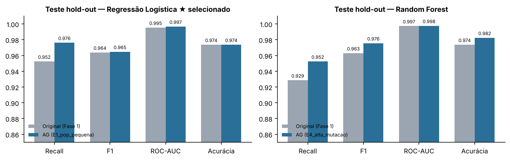
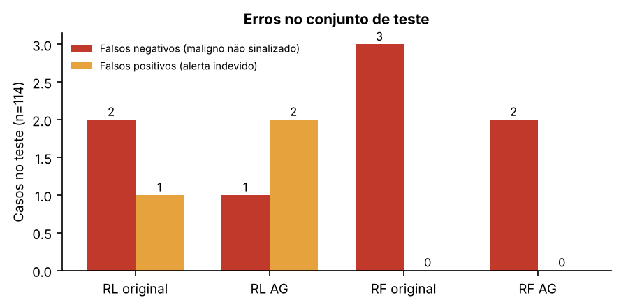
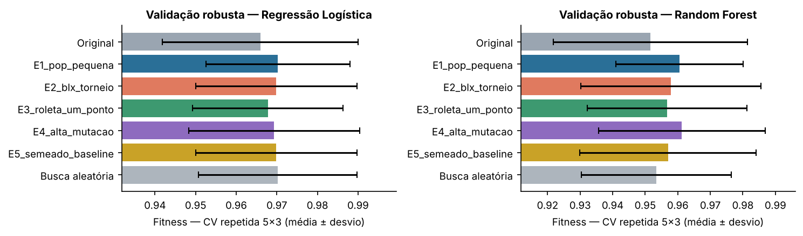
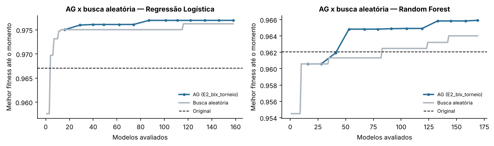
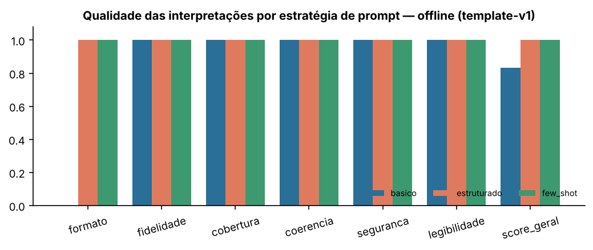
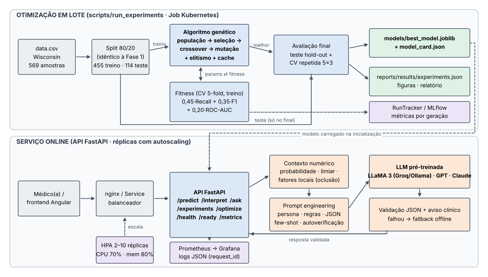

# Otimização de modelos de diagnóstico de câncer de mama com algoritmos genéticos e LLMs

**Relatório técnico — Projeto 1: otimização de modelos de diagnóstico**

Integrantes: Gabriel Wesley (RM376899) · Gustavo Leite (RM375733) · Luiz Fellipe (RM376854)

## Resumo executivo

Este relatório descreve a Fase 2 do Tech Challenge (Projeto 1 — otimização de modelos de diagnóstico). Partindo dos modelos de classificação de câncer de mama da Fase 1 (Regressão Logística e Random Forest sobre o dataset Breast Cancer Wisconsin), implementamos do zero um algoritmo genético para otimizar seus hiperparâmetros — incluindo o limiar de decisão — e integramos uma LLM pré-treinada para explicar os resultados em linguagem natural para médicos.

Foram executados 5 experimentos com configurações diferentes do AG para cada modelo, além de uma busca aleatória com o mesmo orçamento. O modelo selecionado foi a **Regressão Logística** otimizada no experimento **E1_pop_pequena**. No mesmo conjunto de teste da Fase 1 (114 pacientes, 42 malignas), o recall de malignidade foi de 95,2% para 97,6% e os falsos negativos de 2 para 1, com F1 de 0,964 → 0,965 e ROC-AUC de 0,995 → 0,997.

Como o teste tem poucos casos malignos, também medimos o desempenho por validação cruzada repetida (5×3) no treino: o fitness passou de 0,9659 ± 0,0241 para 0,9703 ± 0,0177. A seção 6 discute o tamanho real do ganho.

## 1. Contexto e objetivo

Na Fase 1 o grupo construiu um pipeline de machine learning (com notebook, API FastAPI e frontend Angular) que classifica massas mamárias como benignas ou malignas a partir de 30 medidas morfológicas de núcleos celulares (raio, textura, perímetro, área, concavidade etc., em média, erro-padrão e pior valor). Os modelos usavam hiperparâmetros fixos escolhidos manualmente e limiar de 0,5.

Objetivos desta fase:

- Otimizar os hiperparâmetros dos modelos da Fase 1 com um algoritmo genético (codificação, seleção, cruzamento, mutação e fitness baseada em métricas clínicas).
- Comparar os modelos otimizados com os originais e realizar pelo menos 3 experimentos com configurações diferentes do AG.
- Integrar uma LLM pré-treinada para gerar explicações dos diagnósticos e transformar métricas em insights para médicos, com prompt engineering e avaliação de qualidade.
- Preparar a solução para produção: API, monitoramento, logging e escalabilidade automática.

## 2. Dados e protocolo experimental

Usamos o mesmo arquivo e as mesmas regras de limpeza da Fase 1 (remoção de *id* e da coluna vazia, rótulos M/B → 1/0) e o mesmo split estratificado 80/20 com *random_state=42*: 455 amostras de treino (170 malignas) e 114 de teste (42 malignas). Manter o split idêntico garante que a comparação com a Fase 1 seja justa.

Para evitar vazamento de informação, o protocolo separa claramente busca e avaliação:

- O AG só enxerga o conjunto de treino: cada indivíduo é avaliado por validação cruzada estratificada 5-fold.
- O melhor indivíduo de cada experimento é re-treinado em todo o treino e avaliado (a) no teste hold-out da Fase 1 e (b) numa validação cruzada repetida 5×3 com outra semente (2026).
- O modelo publicado na API é escolhido pela validação repetida — nunca pelo teste.

## 3. Algoritmo genético

### 3.1 Codificação (representação dos genes)

Cada indivíduo é um vetor real x ∈ [0, 1]^d. Cada posição é um gene, decodificado conforme o tipo do hiperparâmetro: genes reais (com escala logarítmica para parâmetros multiplicativos como C), inteiros (arredondamento) e categóricos (o intervalo [0, 1) é dividido em faixas iguais, uma por categoria). Com essa representação os mesmos operadores servem para qualquer modelo, e podemos usar operadores próprios de codificação real, como BLX-α e mutação gaussiana.

**Regressão Logística** — 4 genes:

| Gene | Tipo | Domínio |
|---|---|---|
| C | real (escala log) | [0,001, 100] |
| l1_ratio | real | [0, 1] |
| class_weight | categórico | None, balanced |
| threshold | real | [0,2, 0,8] |

**Random Forest** — 9 genes:

| Gene | Tipo | Domínio |
|---|---|---|
| n_estimators | inteiro | [50, 300] |
| max_depth | categórico | 3, 5, 8, 12, 20, None |
| min_samples_split | inteiro | [2, 20] |
| min_samples_leaf | inteiro | [1, 10] |
| max_features | categórico | sqrt, log2, 0,3, 0,5, 0,8 |
| criterion | categórico | gini, entropy |
| class_weight | categórico | None, balanced, balanced_subsample |
| bootstrap | categórico | True, False |
| threshold | real | [0,2, 0,8] |

O **limiar de decisão** é um gene nos dois modelos. Na triagem de câncer um falso negativo (caso maligno não sinalizado) é muito mais grave que um falso positivo, e o limiar é o controle mais direto desse equilíbrio — na Fase 1 ele estava fixo em 0,5. No Random Forest, n_estimators vai até 300 (a Fase 1 usava 500) para caber no orçamento computacional; a curva de ganho de árvores adicionais é bem plana nessa faixa.

### 3.2 Operadores

| Etapa | Operadores implementados | Papel |
|---|---|---|
| Seleção | Torneio (k=3), roleta (com deslocamento pelo mínimo), ranking linear | Escolher pais; k e o tipo controlam a pressão seletiva |
| Cruzamento | Uniforme, um ponto, BLX-α (α=0,5) | Combinar boas soluções; BLX-α explora além dos pais |
| Mutação | Gaussiana (σ configurável), uniforme (reinicialização) | Manter diversidade; gaussiana faz ajuste fino, uniforme explora |
| Elitismo | Os n melhores passam intactos | Garante que o melhor fitness nunca piora |
| Outros | Cache de fitness, parada antecipada, semeadura com o modelo original | Economia de treinos e convergência controlada |

A roleta usa o fitness deslocado pelo mínimo da população: como os valores ficam muito próximos (0,95–0,98), a roleta pura seria quase aleatória.

### 3.3 Função fitness

fitness = 0,45 · Recall(maligno) + 0,35 · F1(maligno) + 0,20 · ROC-AUC, calculado sobre as probabilidades out-of-fold da CV 5-fold no treino.

- **Recall** tem o maior peso: é a métrica que a Fase 1 já priorizava (não deixar passar casos malignos).
- **F1** impede a solução degenerada "tudo é maligno" (recall 1,0 com precisão baixa), que um limiar muito baixo produziria.
- **ROC-AUC** mede a qualidade da ordenação das probabilidades, independente do limiar.
- Indivíduos que só diferem no limiar reaproveitam as probabilidades já calculadas (sem re-treinar) e indivíduos repetidos vêm do cache — o que reduz bastante o custo, principalmente no Random Forest.

## 4. Experimentos

| Experimento | Pop. | Ger. | Seleção | Crossover | Mutação | Elite | Observação |
|---|---|---|---|---|---|---|---|
| E1_pop_pequena | 10 | 8 | tournament | uniform (0,9) | gaussian (0,10) | 1 |  |
| E2_blx_torneio | 16 | 12 | tournament | blx (0,9) | gaussian (0,15) | 2 |  |
| E3_roleta_um_ponto | 24 | 10 | roulette | one_point (0,8) | gaussian (0,05) | 2 |  |
| E4_alta_mutacao | 16 | 12 | rank | uniform (0,7) | uniform (0,30) | 2 |  |
| E5_semeado_baseline | 16 | 12 | tournament | blx (0,9) | gaussian (0,15) | 2 | semeado c/ original; parada em 6 |

Todos os experimentos usam a mesma semente (42), a mesma fitness e as mesmas dobras de CV, para que as diferenças venham apenas da configuração do AG.

### 4.1 Resultados — Regressão Logística

| Configuração | Fitness CV | CV 5×3 (média ± dp) | Recall teste | F1 teste | AUC teste | FN | FP | Avaliações | Tempo (s) |
|---|---|---|---|---|---|---|---|---|---|
| Original (Fase 1) | 0,9671 | 0,9659 ± 0,0241 | 95,2% | 0,964 | 0,995 | 2 | 1 | — | — |
| E1_pop_pequena | 0,9771 | 0,9703 ± 0,0177 | 97,6% | 0,965 | 0,997 | 1 | 2 | 36 | 8 |
| E2_blx_torneio | 0,9770 | 0,9699 ± 0,0198 | 95,2% | 0,952 | 0,994 | 2 | 2 | 158 | 55 |
| E3_roleta_um_ponto | 0,9780 | 0,9678 ± 0,0185 | 97,6% | 0,943 | 0,997 | 1 | 4 | 145 | 34 |
| E4_alta_mutacao | 0,9763 | 0,9694 ± 0,0211 | 97,6% | 0,976 | 0,997 | 1 | 1 | 148 | 51 |
| E5_semeado_baseline | 0,9770 | 0,9699 ± 0,0198 | 95,2% | 0,952 | 0,994 | 2 | 2 | 158 | 56 |
| Busca aleatória | 0,9763 | 0,9703 ± 0,0195 | 97,6% | 0,976 | 0,997 | 1 | 1 | 158 | 52 |

Melhor configuração pela validação repetida: **E1_pop_pequena**. Hiperparâmetros encontrados: C = 0,5928; l1_ratio = 0,11; class_weight = None; threshold = 0,26. Originais: C = 1; l1_ratio = 0; class_weight = balanced; threshold = 0,5.

### 4.2 Resultados — Random Forest

| Configuração | Fitness CV | CV 5×3 (média ± dp) | Recall teste | F1 teste | AUC teste | FN | FP | Avaliações | Tempo (s) |
|---|---|---|---|---|---|---|---|---|---|
| Original (Fase 1) | 0,9621 | 0,9516 ± 0,0298 | 92,9% | 0,963 | 0,997 | 3 | 0 | — | — |
| E1_pop_pequena | 0,9676 | 0,9606 ± 0,0195 | 92,9% | 0,951 | 0,998 | 3 | 1 | 51 | 144 |
| E2_blx_torneio | 0,9659 | 0,9579 ± 0,0276 | 92,9% | 0,951 | 0,996 | 3 | 1 | 169 | 307 |
| E3_roleta_um_ponto | 0,9674 | 0,9567 ± 0,0246 | 92,9% | 0,963 | 0,995 | 3 | 0 | 162 | 363 |
| E4_alta_mutacao | 0,9663 | 0,9613 ± 0,0256 | 95,2% | 0,976 | 0,998 | 2 | 0 | 177 | 474 |
| E5_semeado_baseline | 0,9650 | 0,9570 ± 0,0271 | 92,9% | 0,951 | 0,998 | 3 | 1 | 108 | 313 |
| Busca aleatória | 0,9640 | 0,9534 ± 0,0231 | 92,9% | 0,963 | 0,997 | 3 | 0 | 169 | 469 |

Melhor configuração pela validação repetida: **E4_alta_mutacao**. Hiperparâmetros encontrados: n_estimators = 65; max_depth = 8; min_samples_split = 5; min_samples_leaf = 2; max_features = sqrt; criterion = entropy; class_weight = None; bootstrap = False; threshold = 0,41. Originais: n_estimators = 500; max_depth = None; min_samples_split = 2; min_samples_leaf = 2; max_features = sqrt; criterion = gini; class_weight = balanced; bootstrap = True; threshold = 0,5.



*Figura 1 — Convergência: melhor indivíduo (linha cheia) e média da população (pontilhada) por geração. A linha tracejada é o fitness do modelo original.*



*Figura 2 — Diversidade da população (desvio-padrão médio dos genes).*

### 4.3 Análise dos experimentos

- **Regressão Logística**: todos os experimentos superaram o fitness do modelo original (0,9671) já nas primeiras gerações. O maior fitness de CV foi do E3_roleta_um_ponto (0,9780); o E1_pop_pequena chegou a 0,9771 com apenas 36 avaliações.
- **Random Forest**: todos os experimentos superaram o fitness do modelo original (0,9621) já nas primeiras gerações. O maior fitness de CV foi do E1_pop_pequena (0,9676); o E1_pop_pequena chegou a 0,9676 com apenas 51 avaliações.
- **Pressão seletiva e diversidade** (Figura 2): com torneio (E1_pop_pequena, E2_blx_torneio, E5_semeado_baseline) a população converge rápido — no E1_pop_pequena a diversidade final ficou em 0,01–0,04. A roleta (E3_roleta_um_ponto), mesmo com mutação baixa, manteve diversidade 0,11–0,15 no fim: como os fitness são muito próximos, ela seleciona quase uniformemente. A mutação alta e uniforme com ranking (E4_alta_mutacao) manteve a maior diversidade (0,23–0,24), o que evita convergência prematura, mas deixa a média da população mais baixa e ruidosa (Figura 1).
- **Tamanho da população e orçamento**: o E1_pop_pequena, com a menor população e o menor número de avaliações, chegou a resultados comparáveis aos experimentos maiores. Com a fitness quase saturada (≈0,97) e espaços de busca pequenos, mais avaliações rendem ganhos marginais — as diferenças entre experimentos ficam dentro do desvio-padrão da validação repetida.
- **Semeadura (E5)**: colocar o modelo original na população inicial não trouxe vantagem. Na Regressão Logística o resultado foi idêntico ao E2 (mesma configuração sem semente): o original é superado logo na primeira geração e a busca segue o mesmo caminho. No Random Forest ficou abaixo do E2 — a semente pode atrair a busca para a vizinhança da solução manual.
- **Cache**: somando todos os experimentos, foram 1312 avaliações de fitness, mas só 1147 combinações de hiperparâmetros precisaram ser treinadas (CV 5-fold) — indivíduos repetidos e variações apenas do limiar reaproveitam resultados.

## 5. Comparativo: modelos originais × otimizados

| Modelo | Versão | Acurácia | Precisão | Recall | F1 | ROC-AUC | FN | FP |
|---|---|---|---|---|---|---|---|---|
| Regressão Logística | Original | 97,4% | 97,6% | 95,2% | 0,964 | 0,995 | 2 | 1 |
| Regressão Logística | AG (E1_pop_pequena) | 97,4% | 95,3% | 97,6% | 0,965 | 0,997 | 1 | 2 |
| Random Forest | Original | 97,4% | 100,0% | 92,9% | 0,963 | 0,997 | 3 | 0 |
| Random Forest | AG (E4_alta_mutacao) | 98,2% | 100,0% | 95,2% | 0,976 | 0,998 | 2 | 0 |



*Figura 3 — Métricas no teste hold-out da Fase 1 (114 amostras).*



*Figura 4 — Falsos negativos e falsos positivos no teste (RL = Regressão Logística, RF = Random Forest).*



*Figura 5 — Fitness na validação cruzada repetida 5×3 (média ± desvio).*

### 5.1 Comparação com outra abordagem: busca aleatória

Para verificar se o AG agrega valor além de testar muitas combinações, comparamos cada modelo com uma busca aleatória que recebe o mesmo número de avaliações do experimento E2. Regressão Logística: AG (E2_blx_torneio) 0,9770 × busca aleatória 0,9763 com 158 avaliações. Random Forest: AG (E2_blx_torneio) 0,9659 × busca aleatória 0,9640 com 169 avaliações.



*Figura 6 — Melhor fitness encontrado em função do número de modelos avaliados: AG × busca aleatória.*

Neste espaço de busca relativamente pequeno (4 e 9 genes) e com fitness quase saturada (≈0,97), a vantagem do AG sobre a busca aleatória é pequena; ela tende a crescer com espaços maiores (mais modelos, seleção de atributos), que são o próximo passo natural.

## 6. Discussão do ganho

O ganho veio principalmente de dois fatores: (1) o **limiar de decisão** — o AG escolheu 0,26 em vez de 0,5, deslocando o ponto de operação para capturar mais casos malignos — e (2) a **regularização**/estrutura do modelo. A diferença de falsos negativos no teste (2 → 1) é clinicamente relevante, mas o teste tem apenas 42 casos malignos: cada caso equivale a 2,4% de recall. Por isso reportamos também a CV repetida, em que as diferenças são menores e os desvios-padrão se sobrepõem parcialmente — o ganho é consistente na direção, mas modesto em magnitude, o que é esperado num dataset em que o modelo original já tinha ROC-AUC ≈ 0,99.

O custo do ganho em recall é visível nos falsos positivos (1 → 2 no teste). Em triagem, um alerta indevido gera um exame adicional; um falso negativo pode atrasar o diagnóstico de um câncer — a fitness foi desenhada para refletir essa assimetria. Os pesos da fitness são configuráveis em configs/experiments.yaml e devem ser validados com a equipe clínica.

## 7. Integração com LLM

### 7.1 Abordagem

A LLM não acessa o modelo nem os dados brutos. Para cada paciente, a API monta um **contexto estruturado (grounding)** com: probabilidade de malignidade, limiar, faixa de risco, os 5 fatores que mais pesaram *para aquela paciente* (com o valor dela e as médias de benignos e malignos no treino) e o desempenho do modelo no teste. Os fatores locais são calculados por **oclusão**: cada atributo é substituído pela mediana do treino e mede-se quanto a probabilidade muda — método agnóstico ao modelo, sem depender do SHAP.

- **Explicação de casos** (/interpret): resumo, fatores relevantes, confiabilidade, recomendação, limitações e aviso, em JSON.
- **Insights de desempenho** (/report/performance): traduz a comparação original × otimizado (recall, falsos negativos etc.) em impacto clínico para a equipe.
- **Perguntas livres** (/ask): o(a) médico(a) pergunta em linguagem natural sobre o caso — base para a integração com dados textuais do Módulo 3.
- **Provedores plugáveis**: qualquer API compatível com OpenAI (LLaMA 3 via Groq ou Ollama local, GPT, LM Studio) e a API da Anthropic, configurados por variáveis de ambiente.
- **Fallback**: se a LLM falha ou responde fora do formato, a API devolve uma explicação por template e registra o evento na métrica llm_requests_total{status="fallback"}.

### 7.2 Prompt engineering

| Técnica | Como foi aplicada | Objetivo |
|---|---|---|
| Persona e público | Assistente de apoio à decisão para mastologistas e patologistas | Vocabulário e nível técnico adequados |
| Grounding | Todos os números vêm do CONTEXTO em JSON | Evitar números inventados |
| Restrições de segurança | Proibido diagnóstico definitivo; aviso obrigatório | Uso responsável em saúde |
| Saída estruturada | Esquema JSON com campos fixos | Exibir no frontend e validar |
| Few-shot | Um par contexto → resposta completo | Tom, tamanho e forma de citar fatores |
| Autoverificação | Checklist silencioso antes de responder | Coerência com o limiar e números |
| Temperatura 0,2 | Parâmetro da chamada | Respostas estáveis |

Três estratégias foram comparadas: **basico** (zero-shot, sem regras), **estruturado** (persona + regras + JSON) e **few_shot** (estruturado + exemplo + autoverificação). Trecho do prompt de sistema usado nas estratégias estruturado e few_shot:

```text
Você é um assistente de apoio à decisão clínica em um hospital universitário.
Seu público são médicos(as) mastologistas e patologistas. Você explica, em português do Brasil,
o resultado de um modelo de machine learning que estima a probabilidade de malignidade de uma
massa mamária a partir de medidas morfológicas de núcleos celulares (exame de PAAF digitalizado).

Regras obrigatórias:
1. Use SOMENTE os números presentes no CONTEXTO. Não invente valores, percentuais ou estatísticas.
2. Nunca afirme diagnóstico definitivo. Não use expressões como "confirma câncer", "é maligno",
   "descarta câncer" ou "não há câncer". Fale em probabilidade estimada e sinal de alerta.
3. Cite os fatores pelo nome em português e compare o valor da paciente com as médias de
   casos benignos e malignos quando isso ajudar a interpretação.
4. Seja objetivo: frases curtas, sem jargão de computação (evite "feature", "pipeline", "threshold").
5. Termine sempre com o aviso de que se trata de apoio à decisão e não substitui avaliação médica.
6. Responda apenas com um objeto JSON válido.
```

### 7.3 Avaliação da qualidade

| Critério | Como é medido |
|---|---|
| formato | JSON válido com todos os campos esperados |
| fidelidade | Fração dos números citados que existem no contexto (detecta alucinação numérica) |
| cobertura | Fração dos 3 fatores principais mencionados |
| coerencia | Texto descreve o risco na mesma direção da classificação (acima/abaixo do limiar) |
| seguranca | Tem aviso de apoio à decisão e não usa linguagem de diagnóstico definitivo |
| legibilidade | Tamanho médio das frases (≤ 25 palavras = 1) |
| juiz (opcional) | Outra LLM dá notas 1–5 para clareza, utilidade clínica, fidelidade e segurança |

Resultados com **offline / template-v1** em 10 casos do teste (erros do modelo, casos próximos ao limiar e casos típicos de cada classe):

| Estratégia | formato | fidelidade | cobertura | coerencia | seguranca | legibilidade | score_geral | latência (s) |
|---|---|---|---|---|---|---|---|---|
| basico | 0,00 | 1,00 | 1,00 | 1,00 | 1,00 | 1,00 | 0,83 | 0,00 |
| estruturado | 1,00 | 1,00 | 1,00 | 1,00 | 1,00 | 1,00 | 1,00 | 0,00 |
| few_shot | 1,00 | 1,00 | 1,00 | 1,00 | 1,00 | 1,00 | 1,00 | 0,00 |



*Figura 7 — Qualidade das interpretações por estratégia de prompt.*

**Atenção:** estes números foram gerados com o provedor *offline* (template determinístico), que serve de referência e de fallback. Para a avaliação com uma LLM real execute *python -m scripts.evaluate_llm --provider groq --judge groq* (ou ollama) e gere o relatório novamente.

Exemplo de explicação gerada (estratégia few_shot):

```text
Resumo: O modelo estimou probabilidade de malignidade de 46.0%, acima do limiar de decisão de 0.26. Faixa de risco: moderado (acima do limiar).

Fatores relevantes:
• textura (pior valor): 41.61 (média benignos 23.7161, média malignos 29.5743) — aumenta o risco
• textura (média): 30.72 (média benignos 18.0486, média malignos 21.7129) — aumenta o risco
• simetria (pior valor): 0.2196 (média benignos 0.2706, média malignos 0.3261) — reduz o risco

Confiabilidade: No conjunto de teste, o modelo (Regressão Logística, otimizado por algoritmo genético) identificou 97.6% dos casos malignos (recall), com 1 falso(s) negativo(s) em 114 amostras.

Recomendação: Priorizar avaliação médica e considerar confirmação por exame de imagem e biópsia, conforme julgamento clínico.

Limitações: Estimativa estatística baseada em medidas morfológicas de núcleos celulares; não considera histórico clínico, imagem ou outros exames.

Aviso: Apoio à decisão: não confirma nem descarta câncer e não substitui a avaliação médica.
```

Exemplo de insights de desempenho para a equipe clínica (/report/performance):

```text
Resumo: O modelo Regressão Logística otimizado por algoritmo genético obteve recall de 97.6% contra 95.2% do modelo original no teste.

Insights:
• Falsos negativos no teste: 2 (original) → 1 (otimizado).
• Falsos positivos no teste: 1 (original) → 2 (otimizado).
• ROC-AUC: 0.995 (original) → 0.997 (otimizado).

Impacto clínico: Menos casos malignos deixariam de ser sinalizados na triagem.

Recomendação: Validar o modelo em dados externos antes de qualquer uso assistencial.

Aviso: Métricas obtidas em base pública e amostra pequena; não substituem validação clínica.
```

## 8. Arquitetura, escalabilidade e monitoramento



*Figura 8 — Arquitetura da solução.*

- **API sem estado** (FastAPI): o modelo é lido de models/best_model.joblib na inicialização; qualquer réplica atende qualquer requisição.
- **Escala local**: docker compose up --scale api=N, com nginx re-resolvendo o DNS das réplicas a cada 10 s.
- **Escala automática** (deploy/k8s/api.yaml): HorizontalPodAutoscaler de 2 a 10 réplicas por CPU (70%) e memória (80%), subida rápida (30 s) e descida lenta (5 min) para evitar oscilação; readiness/liveness probes, rolling update sem indisponibilidade e PodDisruptionBudget.
- **Otimização em lote** (deploy/k8s/ga-job.yaml): o AG roda como Job indexado, um pod por modelo, sem competir com a API. A rota /optimize existe para demonstração (no máximo 1 job por réplica).
- **Monitoramento**: métricas Prometheus em /metrics (volume e latência por rota, requisições em andamento, distribuição das probabilidades previstas para detectar drift, chamadas/latência/fallback da LLM, jobs do AG e melhor fitness) e Grafana no docker-compose.
- **Logging**: logs JSON estruturados com request_id propagado (cabeçalho x-request-id).
- **Rastreamento de experimentos**: cada execução do AG grava parâmetros, métricas por geração e resultado em reports/runs/ e, se MLFLOW_TRACKING_URI estiver definida, também no MLflow.
- A implantação em nuvem é opcional no enunciado; os manifestos Kubernetes funcionam em qualquer cluster gerenciado (EKS, GKE, AKS).

## 9. Organização do código e testes

Projeto Python com Poetry (pyproject.toml) ou venv (requirements.txt), código em src/, scripts de execução em scripts/, configuração em configs/ e notebook de demonstração em notebooks/02_demo_fase2.ipynb. Os testes automatizados (pytest, pasta tests/) cobrem:

- codificação e decodificação dos genes, operadores de seleção, cruzamento e mutação;
- o motor do AG: convergência num problema de referência, elitismo monotônico, reprodutibilidade por semente, cache, parada antecipada, semeadura e tolerância a falhas da fitness;
- dados (split idêntico à Fase 1), modelos, limiar e fitness (inclusive o reaproveitamento sem re-treino);
- LLM: contexto, prompts, extração de JSON, fallback, e os critérios de avaliação (números inventados, linguagem proibida, cobertura e coerência);
- API: health/ready, previsão, validação de entrada, interpretação, perguntas, métricas e job do AG.

## 10. Desafios enfrentados e soluções

| Desafio | Solução |
|---|---|
| Hiperparâmetros de tipos diferentes no mesmo cromossomo | Codificação real normalizada com genes tipados |
| Custo computacional do Random Forest com CV | Cache de fitness, reaproveitamento das probabilidades quando só o limiar muda e faixa de n_estimators ajustada |
| Risco de sobreajustar ao teste | AG só no treino; seleção pela CV repetida; teste usado uma vez |
| Fitness quase saturada (≈0,97) e roleta pouco seletiva | Roleta com deslocamento pelo mínimo e comparação com torneio e ranking |
| Solução trivial "tudo maligno" ao otimizar recall | F1 e AUC na fitness |
| API depreciou penalty na Regressão Logística (scikit-learn ≥ 1.8) | Uso de l1_ratio com verificação de versão |
| LLM pode inventar números ou dar diagnóstico definitivo | Grounding, regras no prompt e avaliação automática de fidelidade e segurança |
| LLM indisponível ou resposta fora do formato | Validação do JSON e fallback por template, monitorado |
| Atributos correlacionados geram contribuições contraintuitivas na oclusão | Contexto inclui as médias por classe para o médico interpretar; documentado como limitação |

## 11. Limitações e próximos passos

- Dataset público e pequeno (569 amostras); antes de qualquer uso assistencial é necessária validação externa e prospectiva com dados do hospital.
- Os pesos da fitness refletem uma preferência por recall que deve ser definida com a equipe clínica.
- Explicações locais por oclusão não tratam a correlação entre atributos (ex.: raio, perímetro e área).
- Próximos passos (Módulo 3): ampliar o espaço de busca (seleção de atributos, outros algoritmos), otimização multiobjetivo (NSGA-II) para a fronteira recall × falsos positivos, integrar laudos textuais ao contexto da LLM e expor as explicações no frontend Angular da Fase 1.

## 12. Como reproduzir

```text
cd tech-challenge-fase2
python -m venv .venv && source .venv/bin/activate   # Windows: .venv\Scripts\activate
pip install -r requirements.txt                     # ou: poetry install
python -m scripts.run_experiments                   # AG: todos os experimentos
python -m scripts.evaluate_llm --provider groq      # avaliação da LLM (GROQ_API_KEY no .env)
python -m scripts.make_figures && python -m scripts.generate_report
pytest                                              # testes
uvicorn src.api.main:app --port 8000                # API em http://localhost:8000/docs
```

Repositório: https://github.com/Gusta2150/desafio_tech
